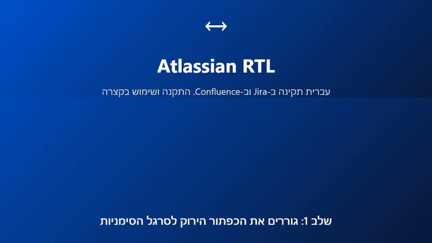

# Atlassian RTL

**עברית שנראית נכון ב-Jira וב-Confluence.**

[דף ההתקנה](install-rtl.html) · [סרטון הדגמה](install-guide.mp4) · [English below](#english)

תוכן מעורב הוא המקום שבו Atlassian נשברת בעברית: משפט שנגמר ב-`(Jira)`, מפתח משימה באמצע פסקה, בלוק קוד מתחת לכותרת. הטקסט נוחת בצד הלא נכון, הפיסוק קופץ לקצה השני, והרשימות נראות שבורות.

הרכיב מתקן את **התצוגה** של התוכן הזה, בעמוד שמולכם, בלחיצה אחת.

| לפני | אחרי |
|---|---|
| פסקאות בעברית מיושרות שמאלה, פיסוק בצד הלא נכון | מיושרות ימינה וקריאות |
| מפתחות משימה ומילים באנגלית מבלבלים את המשפט | כל פסקה מקבלת כיוון משלה |
| בלוקי קוד יורשים RTL ונשברים | קוד, נתיבים וכתובות נשארים משמאל לימין |

## התקנה בפחות מדקה

בלי תוסף ובלי הרשאות מנהל. ההתקנה היא **סימנייה עם קוד** (Bookmarklet), ולכן היא עובדת גם במחשבים שבהם התקנת תוספים חסומה.

1. **להוריד את דף ההתקנה ולפתוח אותו בכרום.** נכנסים ל-[install-rtl.html](install-rtl.html) ב-GitHub, לוחצים על כפתור ההורדה (**Download raw file**) בפינה הימנית העליונה של הקובץ, ואז פותחים את הקובץ מתיקיית ההורדות (Downloads) בכרום. חשוב להוריד, כי בתוך GitHub הדף מוצג כקוד ולא ניתן לגרור ממנו את הכפתור.
2. **לגרור את הכפתור הירוק לסרגל הסימניות (המועדפים).** הסרגל מוסתר? `Ctrl`+`Shift`+`B`. אם הגרירה לא עובדת, באותו דף יש חלופה של העתקה והדבקה.
3. **לפתוח Jira או Confluence וללחוץ על הסימנייה.** כפתור צף מופיע בפינת העמוד. זהו.

מעדיפים לראות קודם? הסרטון עובר על כל זה בכ-40 שניות (לחיצה על התמונה פותחת את הסרטון בגודל מלא):

## שימוש

לוחצים על הכפתור הצף, או על `Ctrl`+`Alt`+`R`, כדי לעבור בין שלושה מצבים:

| מצב | הכיתוב על הכפתור | מה הוא עושה |
|---|---|---|
| אוטומטי | הצג עברית אוטומטית | מחליט על הכיוון פסקה אחר פסקה. ברירת המחדל. |
| תמיד | כפה עברית תמיד | כופה ימין-לשמאל בכל אזורי התוכן. |
| כבוי | כבה את הרכיב | מסיר כל שינוי, בלי להשאיר עקבות בעמוד. |

לחיצה עם `Shift` מסתירה את הכפתור הצף. הקיצור `Ctrl`+`Alt`+`R` ממשיך לעבוד.

### בכל פעם שחוזרים

סימנייה לא יכולה לרוץ לבד בעת טעינת עמוד. לכן **אחרי רענון, פתיחת טאב חדש או כניסה מחודשת ל-Atlassian, לוחצים על הסימנייה שוב.** מעבר בין עמודים בתוך Confluence לא דורש לחיצה נוספת.

מה שלא צריך לעשות מחדש הוא את הבחירה עצמה. המצב שבחרתם (כבוי, אוטומטי או תמיד) נשמר ומופעל מיד כשלוחצים על הסימנייה.

### איפה ההגדרה נשמרת

המצב נשמר ב-`localStorage` של הדפדפן, תחת המפתח `crtl:crtlMode`. בפועל:

- הוא נשאר אחרי רענון וסגירת הדפדפן, בלי שרת ובלי חשבון.
- הוא שייך ל**דפדפן הזה ולאתר הזה**. דפדפן אחר, מחשב אחר או כתובת Atlassian אחרת מתחילים ממצב אוטומטי.
- ניקוי נתוני האתר מחזיר למצב אוטומטי.
- שום דבר לא נשלח לשום מקום.

## מה זה עושה ומה לא

שכבת תצוגה בלבד. הרכיב משנה כיווניות ויישור טקסט על המסך. הוא לא קורא את התוכן, לא שולח דבר לשום שרת ולא נוגע במה שנשמר ב-Atlassian. סוגרים את הטאב והוא נעלם.

בלוקי קוד, קוד בתוך שורה, נתיבים וכתובות נשארים תמיד משמאל לימין.

## קבצים

| קובץ | תפקיד |
|---|---|
| [install-rtl.html](install-rtl.html) | דף ההתקנה עם הכפתור לגרירה |
| [install-guide.mp4](install-guide.mp4) | הסרטון (כ-40 שניות) |
| [LICENSE](LICENSE) | רישיון MIT |

## הבהרה משפטית

**זהו פרויקט עצמאי של קוד פתוח. Atlassian לא יצרה אותו, לא אישרה אותו, לא תומכת בו ואינה קשורה אליו בשום צורה.**

השמות Atlassian, Jira ו-Confluence הם סימנים מסחריים של Atlassian Pty Ltd, והשימוש בהם בא רק לציין עם אילו מוצרים הרכיב עובד. הרכיב משנה את התצוגה בדפדפן שלכם בלבד, ובעיות בו אין לדווח לתמיכה של Atlassian. השימוש באחריותכם, ובארגון שלכם כדאי לוודא שהמדיניות מתירה סימניות עם קוד.

## רישיון

הרישיון הוא [MIT](LICENSE). מותר להשתמש, להעתיק, לשנות ולהפיץ, גם בארגון וגם באופן מסחרי, בתנאי ששומרים את הודעת הזכויות והרישיון. התוכנה ניתנת "כמות שהיא", ללא אחריות מכל סוג.

---

# Atlassian RTL (English)

**Hebrew that looks right in Jira and Confluence.**

Mixed content is where Atlassian breaks down for Hebrew: a sentence that ends with `(Jira)`, a ticket key in the middle of a paragraph, a code block under a heading. Text lands on the wrong side, punctuation jumps to the wrong end, lists look broken. Atlassian RTL fixes the *display* of that content on the page in front of you, with one click.

## Install in under a minute

No extension and no admin rights. It installs as a **bookmarklet** (a bookmark that runs a small script), so it works on computers where installing browser add-ons is blocked.

1. **Download the install page and open it in Chrome.** Go to [install-rtl.html](install-rtl.html) on GitHub, click **Download raw file** (top-right of the file view), then open the file from your Downloads folder in Chrome. You need to download it, because GitHub shows the page as code and you can't drag the button from there.
2. **Drag the green button to your bookmarks bar.** Bookmarks bar hidden? Press `Ctrl`+`Shift`+`B`. The same page has a copy-and-paste alternative if dragging fails.
3. **Open Jira or Confluence and click the bookmark.** A floating button appears in the corner of the page.

Prefer to watch first? The video covers all of this in about 40 seconds (click the image to open the full-size video):

## Use

Click the floating button, or press `Ctrl`+`Alt`+`R`, to cycle through three modes:

| Mode | What it does |
|---|---|
| Auto | Decides direction paragraph by paragraph. The default. |
| Always | Forces right-to-left on all content areas. |
| Off | Removes every change and leaves no trace on the page. |

`Shift`+click hides the floating button. The `Ctrl`+`Alt`+`R` shortcut keeps working.

**Every time you come back:** a bookmark cannot run by itself when a page loads, so after a refresh, a new tab or a fresh visit to Atlassian, click the bookmark once more. Moving between pages inside Confluence needs no extra click. Your *mode*, however, is remembered and applied automatically.

**Where the setting lives:** in the browser's `localStorage` under the key `crtl:crtlMode`. It survives refreshes and restarts with no server and no account, but it belongs to this browser and this site only. Another browser, computer or Atlassian address starts from Auto, and clearing site data resets it.

## What it does, and what it doesn't

It is a display layer only. It changes text direction and alignment on your screen. It doesn't read your content, send anything to any server, or touch what Atlassian stores. Code blocks, inline code, paths and URLs always stay left-to-right.

## Disclaimer

**This is an independent, open-source project. It was not created, endorsed, sponsored or supported by Atlassian, and it is not affiliated with Atlassian in any way.**

Atlassian, Jira and Confluence are trademarks of Atlassian Pty Ltd; the names are used only to say which products this works with. It changes how pages look in your own browser only. Do not report problems with it to Atlassian support. Use it at your own risk, and check that your organisation's policy allows bookmarklets.

## License

[MIT](LICENSE). You may use, copy, modify and distribute it, including inside a company and commercially, as long as you keep the copyright and licence notice. The software is provided "as is", without warranty of any kind.

